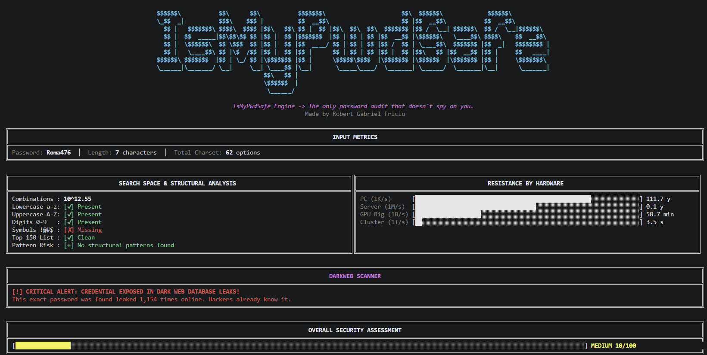
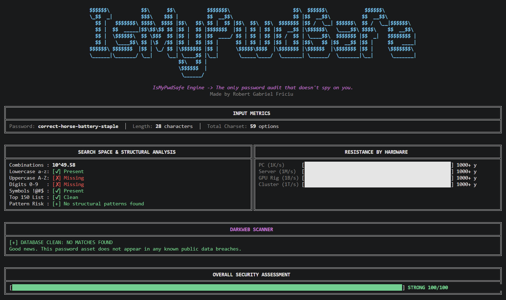
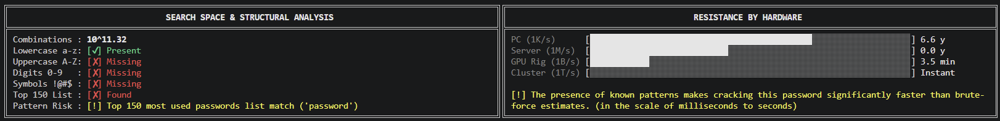
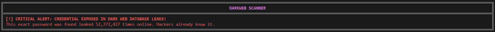
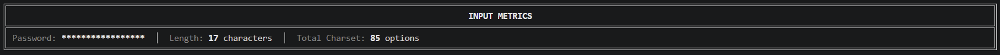

<h1 align="center"> IsMyPwdSafe - The only password audit that doesn't spy on you.</h1>

<p align="center">
  <a href="https://github.com/Roma476/IsMyPwdSafe">
    
  </a>
  <p align="center">A privacy-first command-line password auditor.<br>Entropy math, pattern detection and breach lookup - all from your terminal.</p>
  <p align="center">
    <a href="https://pypi.org/project/ismypwdsafe/"></a>
    &nbsp;&nbsp;&nbsp;
    <a href="https://pypi.org/project/ismypwdsafe/"></a>
  </p>
</p>

[](https://pypi.org/project/ismypwdsafe/)
[](https://www.python.org/)
[](LICENSE)
[](#installation)
[](https://github.com/Roma476/IsMyPwdSafe/issues)
[-63e6b4?style=flat-square)](pyproject.toml)
[](#privacy-and-network)

**Read this before you run it:** `imps "your-password"` puts the password in your shell history, terminal scrollback and any log your terminal writes to. If you need the password out of history, prefix the command with a space (requires `HISTCONTROL=ignorespace` in bash/zsh), clear the history after or wait for the interactive mode on the roadmap. This tool is an audit utility - **it is not a password manager.** Do not use it as one.

> **Project status - actively developed.** IsMyPwdSafe is under active development. A `--offline` flag that skips both network calls (HIBP and the GitHub version check) is planned for the next release, so a fully offline audit will be a single flag instead of a firewall rule. Additional flags are in progress. If you have ideas, want to report a bug or want to contribute, open an [issue](https://github.com/Roma476/IsMyPwdSafe/issues) or a [pull request](https://github.com/Roma476/IsMyPwdSafe/pulls). See [Roadmap](#roadmap) and [Contributing](#contributing).

---

## Quick Start

### 1. Install

The only runtime dependency is `requests`. `pipx` gives you a global `imps` command in an isolated venv:

```bash
pipx install ismypwdsafe
```

`pip` works too if you prefer a shared environment:

```bash
pip install ismypwdsafe
```

From source, or without installing at all:

```bash
git clone https://github.com/Roma476/IsMyPwdSafe.git
cd IsMyPwdSafe
pip install .
# or
python -m ismypwdsafe.main "correct-horse-battery-staple"
```

### 2. Run an audit

```bash
imps "correct-horse-battery-staple"
```



The engine computes the charset, the number of possible combinations, the estimated time to crack on four hardware profiles and the HaveIBeenPwned result. All in one pass, all locally apart from the two HTTP requests listed below.

### 3. Run an audit on a known-weak password

```bash
imps "password"
```

Two independent things fire here. The pattern engine matches `password` against the top-150 dictionary and caps the score at 30. The HaveIBeenPwned lookup finds the password in breach data and caps at 10. The final result is a `WEAK 10/100` with two separate warnings in the DARKWEB SCANNER panel and the SEARCH SPACE panel:





### 4. Mask the password in the output

If you are auditing on a shared screen or a recording:

```bash
imps -M "MySecretPassword!"
```



The password appears as `************` in the INPUT METRICS panel. Everything else is computed normally.

<p align="right">(<a href="#top">back to top</a>)</p>

---

## What IsMyPwdSafe can do

| Feature | Description |
| ------- | ----------- |
| [Entropy estimation](#charset-and-entropy) | Charset detection and `C^L` combination count with log10 fallback for large search spaces |
| [Top-150 dictionary](#rule-1-top-150-dictionary) | Substring match against the 150 most-used passwords, with leet-speak normalization |
| [QWERTY walk detection](#rule-2-qwerty-spatial-walk) | Real keyboard coordinate model catching `qwerty`, `1qaz2wsx`, `zxcvbn` and similar walks |
| [Common year detection](#rule-3-common-year) | Flags 4-digit runs in the 1900-2050 range |
| [Character repetition](#rule-4-character-repetition) | Flags three or more identical consecutive characters |
| [HaveIBeenPwned range lookup](#network-behavior) | k-anonymity breach check; only a 5-character SHA-1 prefix leaves the machine |
| [Hardware resistance graph](#scoring) | Estimated time-to-crack on PC, server, GPU rig and cluster |
| [Privacy mask mode](#4-mask-the-password-in-the-output) | `-M` / `--Mask` replaces the password with asterisks in all output |
| [Skip update check](#network-behavior) | `--no-update-check` disables the single GitHub request at startup |

<p align="right">(<a href="#top">back to top</a>)</p>

---

## Use Cases

- **Personal audit** - check your own passwords without pasting them into an unknown web form. Useful before migrating to a password manager.
- **Security training** - show colleagues the actual difference between `Summer2024!` and `correct-horse-battery-staple` in entropy numbers and time-to-crack instead of vague "strong/weak" labels.
- **Assessing leaked credentials** - when a plaintext password turns up in a dump or during a CTF, check how strong it actually is before deciding whether to report it as critical.
- **Pre-deployment checks** - quick scan of default passwords or example strings before they ship in a config file.

<p align="right">(<a href="#top">back to top</a>)</p>

---

## Detection engine

The score is not a linear function of length. It combines a mathematical entropy estimate with a set of pattern rules that catch the cases where entropy is misleading - `Password123` has non-trivial entropy on paper but is trivially guessable because the pattern is known.

### Charset and entropy

Each character contributes to the charset once:

| Class | Contribution |
| ----- | ------------ |
| Digits `0-9` | +10 |
| Lowercase `a-z` | +26 |
| Uppercase `A-Z` | +26 |
| Printable ASCII symbols | +33 |

Non-ASCII characters do not contribute to the estimate - the search space is modelled over printable ASCII only. Total combinations are `C^L` and entropy in base 10 is `L * log10(C)`.

For large search spaces the raw `C^L` overflows the display width, so the engine switches to log-space representation (`10^x`). The switch is decided by `must_use_log(C, L)`:

| Condition | Behaviour |
| --------- | --------- |
| `C > 95` and `L >= 3` | log-space |
| `C ∈ {62, 63}` and `L >= 5` | log-space |
| Otherwise | `L >= 4` → log-space |

That is why some outputs show `10^39.65` instead of a full integer - it is precise and it fits the panel.

### Rule 1: Top-150 dictionary

Substring match against the top-150 most-used passwords. Before matching, the input is lowercased and normalized through a leet-speak translation table:

```
@ → a    4 → a    3 → e    0 → o    1 → i
! → i    $ → s    5 → s    7 → t    8 → b
```

So `P@ssw0rd` becomes `password` and is caught. `MyPassword123` also matches because `password123` is a substring of the normalized input. This is the most aggressive rule - it is why so many "clever" passwords still score low.

### Rule 2: QWERTY spatial walk

Each key is mapped to a `(row, column)` coordinate on a real QWERTY keyboard:

```
row 0:  1 2 3 4 5 6 7 8 9 0
row 1:  q w e r t y u i o p
row 2:  a s d f g h j k l
row 3:  z x c v b n m
```

The engine looks for at least 4 consecutive keys moving in the same direction - horizontal, vertical or diagonal. When it finds a run, the password gets flagged. This catches the entire family of keyboard walks that look random to a human but are not:

```bash
imps "qwertyuiop"    # horizontal walk
imps "1qaz2wsx"      # diagonal walk
imps "mnbvcxz"       # horizontal reverse walk
imps "1qaz"          # vertical walk
```

### Rule 3: Common year

Scans for a 4-digit run in the `1900-2050` range. `MyPassword2024` and `Summer1990!` both trip this rule even if the surrounding text is clean. This is not a hard match against a list of years - it catches any 4-digit number in the plausible-year range, which is the pattern most people add to a base word when a site forces a "number" requirement.

### Rule 4: Character repetition

Any three or more identical consecutive characters. Catches `aaa`, `111`, `...` and the family of `password!!!` variants. Padding is not entropy.

### Scoring

```
base_score = min(100, max(0, log10_value * 5))

if pattern_detected:    base_score = min(base_score, 30)
if pwned_count > 0:     base_score = min(base_score, 10)
```

| Score | Rating |
| ----- | ------ |
| 0-9 | WEAK (pwned) |
| 10-29 | WEAK (pattern) |
| 30-49 | WEAK |
| 50-69 | MEDIUM |
| 70-100 | STRONG |

The score is capped, not weighted. A single pattern match is treated as a binary event because in practice, once one obvious pattern exists, the rest of the string is no longer the bottleneck - the attacker is running a dictionary or a walk generator, not a brute-force sweep.

<p align="right">(<a href="#top">back to top</a>)</p>

---

## Privacy and network behavior

The tool makes **two outbound HTTP requests** and no others.

### 1. HaveIBeenPwned Range API

The plaintext password and the full SHA-1 hash never leave the machine. Only a 5-character prefix is transmitted, following the [k-anonymity model recommended by HIBP](https://haveibeenpwned.com/API/v3#PwnedPasswords) and used by Firefox, 1Password and Bitwarden:

```
sha1    = SHA1(password)
prefix  = sha1[:5].upper()
suffix  = sha1[5:].upper()

GET https://api.pwnedpasswords.com/range/{prefix}
  → server returns ~800 candidate suffixes
  → local match of `suffix` against the response
```

- **Transmitted:** the 5-character SHA-1 prefix.
- **Not transmitted:** plaintext password, full hash, length, character composition, any IP-linked identifier.
- **Timeout:** 5 seconds.
- **On failure:** the DARKWEB panel shows a warning and the score is computed without the breach cap. The rest of the audit runs normally.

### 2. GitHub version check

A single `GET` to `raw.githubusercontent.com/Roma476/IsMyPwdSafe/main/version.txt` at startup. No identifier, no analytics, no telemetry. It exists solely to warn if a newer version is available. 1.5-second timeout, silent failure.

Disable with `--no-update-check`.

### Skipping network calls

Today the two requests are controlled separately:

```bash
imps --no-update-check "your-password"    # skips the GitHub request
```

A `--offline` flag that disables **both** requests in a single switch is in progress and will land in the next release. Until then, a fully air-gapped run requires blocking `api.pwnedpasswords.com` and `raw.githubusercontent.com` at the firewall; the audit still works minus the DARKWEB panel.

### What the tool does not do

- No telemetry, no analytics, no crash reporting
- No account, no email, no local history of past audits
- No file writes (no logs, no cache, no config on first run)

<p align="right">(<a href="#top">back to top</a>)</p>

---

## Known limitations

- **Shell history.** `imps "pass"` ends up in bash/zsh history, terminal scrollback and any log the terminal writes to. Workaround: prefix the command with a space (requires `HISTCONTROL=ignorespace`) or clear history afterwards. An interactive mode that reads from stdin without echoing is on the roadmap.
- **Two network calls still happen by default.** `--no-update-check` only disables the GitHub request. Disabling the HIBP request currently requires firewall rules; the `--offline` flag on the roadmap will cover both.
- **ASCII only.** The charset is estimated over printable ASCII. Non-ASCII passwords are underestimated in entropy.
- **Finite pattern list.** Top-150 plus four structural rules. An uncommon password is not automatically strong - it is only not *obviously* weak.
- **Crack times are theoretical.** They assume a constant hash rate on a given hardware profile. They do not model rainbow tables, targeted dictionaries, GPU-specific optimizations or side channels.
- **DARKWEB depends on HIBP.** If the API changes behaviour the panel reports it, but the tool does not update itself.
- **No automated test suite yet.** Manual checks are documented in [Checks](#checks). The roadmap includes a `unittest` suite and a GitHub Actions workflow.

<p align="right">(<a href="#top">back to top</a>)</p>

---

## Checks

```bash
# Minimal run
imps "test"

# Strong password, no pattern
imps "correct-horse-battery-staple"

# Walk pattern - should show pattern warning
imps "qwertyuiop"

# Known breach - should show red alert in the DARKWEB SCANNER
imps "123456"

# Mask mode
imps -M "password"

# Skip update check
imps --no-update-check "password"
```

<p align="right">(<a href="#top">back to top</a>)</p>

---

## Project layout

```text
IsMyPwdSafe/
├── ismypwdsafe/
│   ├── __init__.py
│   └── main.py          # CLI, ~700 lines, single file
├── docs/screenshots/    # README screenshots
├── .gitignore
├── LICENSE              # MIT
├── pyproject.toml
├── version.txt
└── README.md
```

The CLI is a single file by design. It can be read end-to-end in one session and copied to any machine to run with `python main.py "password"` without installation.

<p align="right">(<a href="#top">back to top</a>)</p>

---

## Roadmap

Actively in progress, in rough order of priority:

- **`--offline` flag** - skips both the HIBP and the GitHub requests in a single switch, so a fully offline audit does not require firewall rules.
- **`--json` output** - machine-readable audit result for scripting and CI pipelines.
- **`--quiet` mode** - exit code only, useful in pre-commit hooks and pipelines.
- **Interactive / stdin mode** - read the password without echoing it and without putting it in shell history.
- **Test suite and CI** - `unittest` coverage for the entropy engine, the pattern rules and the score caps, plus a GitHub Actions workflow on 3.8 / 3.10 / 3.12.
- **Expanded pattern dictionary** - the top-150 list is a starting point, not the endpoint.

Out of scope by design: password storage, account systems, cloud sync. IsMyPwdSafe is an audit tool, not a password manager.

<p align="right">(<a href="#top">back to top</a>)</p>

---

## Contributing

Contributions are welcome. Bug reports, feature requests and pull requests all help.

**If you want to contribute but the codebase is new to you**, open an issue first and describe what you would like to do - new pattern rules, additional hardware profiles in the resistance graph and new flags are all good entry points. Nothing here is locked in.

```bash
git clone https://github.com/YOUR-USERNAME/IsMyPwdSafe.git
cd IsMyPwdSafe
python -m venv .venv
source .venv/bin/activate     # Linux/macOS
.venv\Scripts\activate        # Windows
pip install -e .

imps "test-password"
```

For non-trivial changes please open an issue first to agree on the approach.

<p align="right">(<a href="#top">back to top</a>)</p>

---

## Contact

- **Issues / ideas:** [github.com/Roma476/IsMyPwdSafe/issues](https://github.com/Roma476/IsMyPwdSafe/issues)
- **Pull requests:** [github.com/Roma476/IsMyPwdSafe/pulls](https://github.com/Roma476/IsMyPwdSafe/pulls)

If you have a feature in mind that is not on the roadmap, or you disagree with something already on it, say so - the roadmap above is a plan, not a contract.

<p align="right">(<a href="#top">back to top</a>)</p>

---

## License

Released under the MIT License. See [`LICENSE`](LICENSE) for the full text.